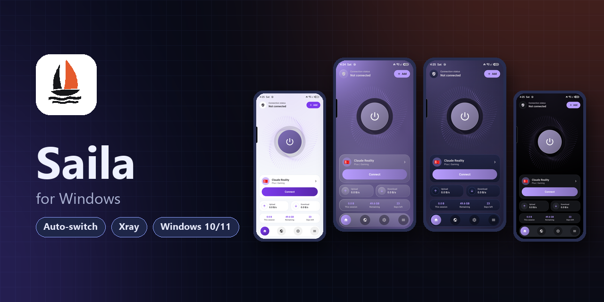

  

<h1 align="center">Saila for Windows</h1>

  Simple VPN client for Windows (Xray). Android version: <a href="https://github.com/Plus98ir/Saila">Plus98ir/Saila</a> · <a href="https://plus98ir.github.io/Saila/">Website</a>

---

## Download

Get `Saila-windows-64.zip` from [Releases](https://github.com/Plus98ir/Saila/releases/latest), extract it anywhere and run `Saila.exe`. Xray-core is included; no install needed. Windows 10/11, 64-bit.

## What is different from v2rayN

- Saila name and icon; settings are kept apart from v2rayN, so both can be installed.
- Default routing **Iran direct**: Iranian sites and IPs go direct, everything else through the proxy.
- Local proxy port **10818** (does not clash with v2rayN's 10808).
- Subscription User-Agent `Saila/<version>`; downloads and updates come from [Plus98ir/Saila](https://github.com/Plus98ir/Saila/releases/latest).
- No promotion menu.

Coming next, like the Android app: simple home with one connect button, auto-switch with a reserve server, server flags, MASQUE/XDRIVE from 3X-UI JSON subscriptions.

---

## دانلود

فایل `Saila-windows-64.zip` را از [Releases](https://github.com/Plus98ir/Saila/releases/latest) بگیرید، هر جا خواستید باز کنید و `Saila.exe` را اجرا کنید. هسته‌ی Xray داخلش هست و نصب لازم ندارد. ویندوز ۱۰ و ۱۱، ۶۴ بیتی.

## فرق با v2rayN

- اسم و آیکون Saila؛ تنظیماتش جدا از v2rayN است و هر دو می‌توانند کنار هم نصب باشند.
- مسیریابی پیش‌فرض **ایران مستقیم**: سایت‌ها و IPهای ایرانی مستقیم، بقیه از طریق پروکسی.
- پورت پروکسی محلی **10818** (با 10808 در v2rayN تداخل ندارد).
- User-Agent اشتراک `Saila/<نسخه>`؛ دانلود و آپدیت از [Plus98ir/Saila](https://github.com/Plus98ir/Saila/releases/latest).
- بدون منوی تبلیغات.

قدم‌های بعدی، مثل نسخه‌ی اندروید: صفحه‌ی ساده با یک دکمه‌ی اتصال، سوییچ خودکار با سرور رزرو، پرچم سرورها، و MASQUE/XDRIVE از اشتراک JSON پنل‌های 3X-UI.

---

Based on [v2rayN](https://github.com/2dust/v2rayN) by 2dust and [Xray-core](https://github.com/XTLS/Xray-core) · [GPL-3.0](LICENSE)
